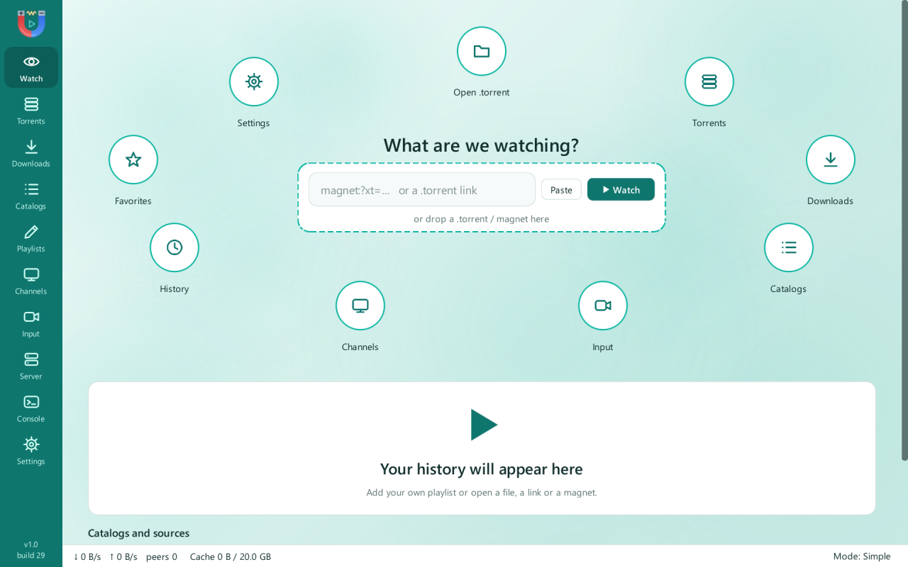
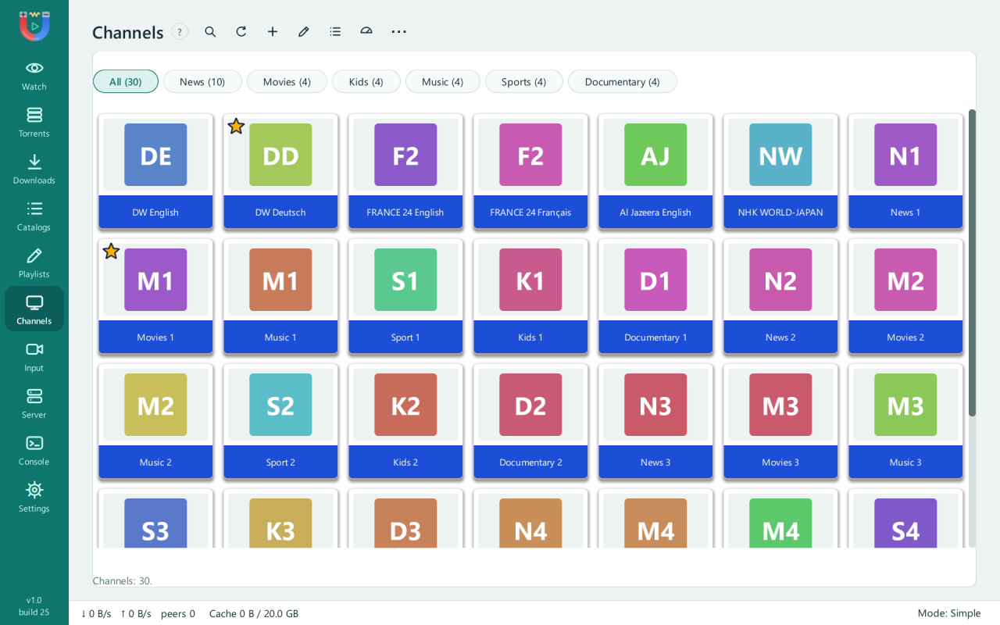
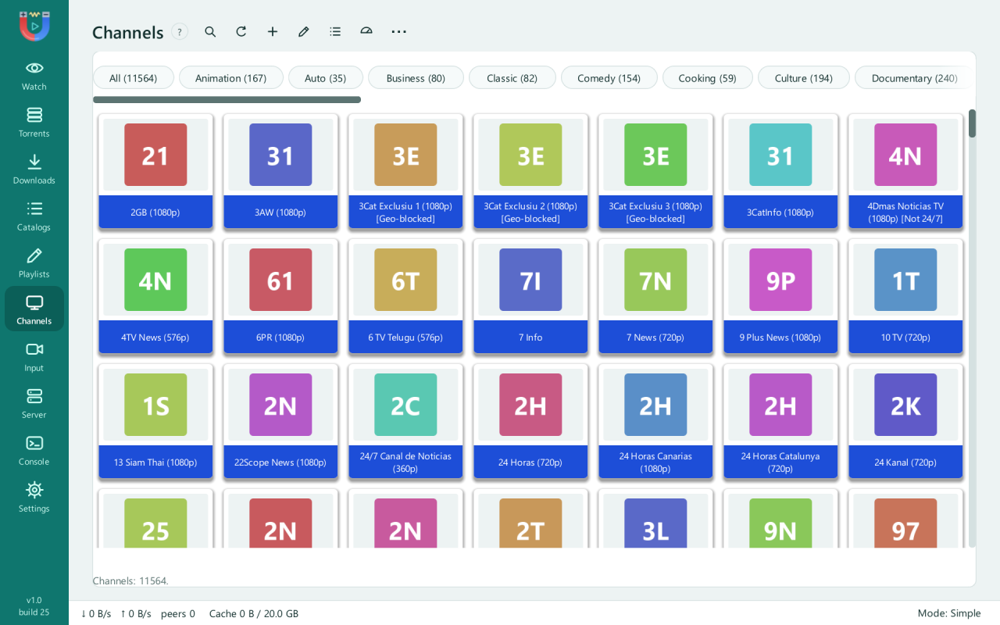
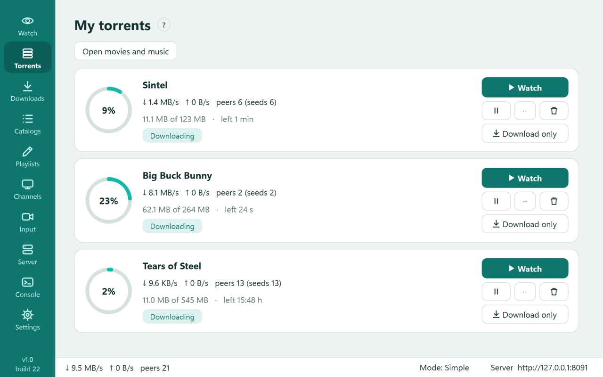
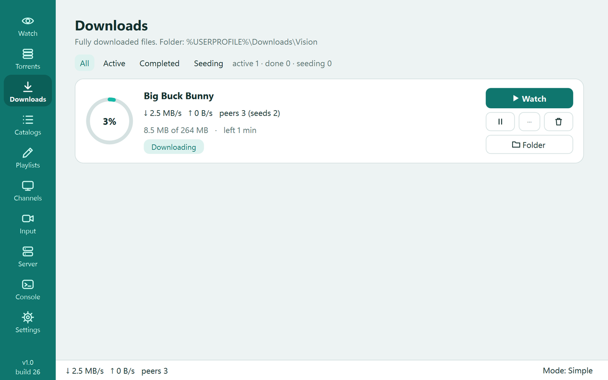

[English](README.md) · [Русский](README.ru.md) · [Українська](README.uk.md)

🌐 All our programs: https://drugoj00.github.io/ · Telegram channel: https://t.me/PhoneInWindowSound

# Vision for Windows

A video player and torrent downloader for Windows in one window: paste a link, press "Watch", and the film plays at once while it keeps downloading. IPTV channels, camera and microphone input, a separate video window. No ads.

Vision plays files, links, playlists and torrents (magnet and .torrent), including while they download. It is also a full downloader: queue, limits, schedule, seeding, moving finished files.

**The program provides no content. The user is responsible for complying with the copyright laws of their country.**

⭐ If the program is useful, please star this repository: it costs nothing and helps other people find it.

## Download

**Version 1.0.** [Vision-Win-1.0.exe](https://github.com/drugoj00/vision-for-windows/releases/download/v1.0/Vision-Win-1.0.exe) · [Releases](https://github.com/drugoj00/vision-for-windows/releases)

SHA-256: `b9b4bfd8a510dd4775c7e1f544fd312fecc29c89f752fe2bf9d6f7658a93982e`

The installer is not yet signed with a publisher certificate: Windows may show a SmartScreen warning ("Unknown publisher"). Press "More info", then "Run anyway". Administrator rights are not needed to install.

## What's new in 1.0

- First release: watching torrents while they download, downloader, IPTV channels, camera and microphone input
- Separate video window: clean, panel on click; pause, volume, "return", "close", and while recording also record and snapshot
- Face tracking and camera presets "For a video call" and "For recording"
- "What are we watching?" home screen with quick action buttons; simple and detailed modes
- Program update with a visible installer window, no silent installs
- Russian, Ukrainian and English, light and dark themes

## Features

- **Watching torrents.** A magnet link, a file or a .torrent address, drag and drop into the window, "Watch link from clipboard". The file list comes first, then the chosen file plays. Seek anywhere, "Continue" from where you stopped.
- **Two engines.** "Auto" (default), "Fast" and "Classic": the fast one drives watching, the classic one handles downloads, the queue and seeding. Choose in Settings → Engine and cache.
- **Downloader.** Queue, speed limits, schedule, seeding (upload, time limit), moving finished files to the folder you need, file check, actions on completion.
- **Player.** Audio and subtitle track choice, external subtitles, speed, frame snapshot, full screen with a panel (hides after 5 seconds or stays), "Click on video" (show the panel or pause), hardware decoding.
- **Channels.** IPTV playlists (M3U, M3U8), groups, favorites, cards with logos, a playlist editor.
- **Input.** Webcams, microphones and other devices: viewing, recording to a file, snapshot, mirror, resolution and frame rate, image and sound settings (auto level, noise suppression), face tracking, presets "For a video call" and "For recording".
- **Separate video window.** Size by mouse wheel, always on top if you choose, transparency, mirror, thin frame; recording goes on while the main window is closed.
- **File types.** Registers .torrent, magnet, .m3u and other types; "Make the default program".
- **Tray icon.** Runs in the background, starts with Windows, a single copy of the program.
- **Browser extension** "Vision-open": sends a link to the program.
- **Updates.** Check on GitHub, checksum verification, a "What's new" window, installation with a visible window.

## Requirements and limits

- Windows 10 (1809 or newer) or Windows 11, 64-bit. Internet is needed for torrents and IPTV.
- Face tracking looks for faces seen from the front (not in profile); the face must take at least 15% of the frame width. Camera recording is not cropped: tracking affects the view only.
- In countries where torrents are prohibited they are blocked until confirmation; the country is detected offline.
- Tested on Windows 11. Not verified live: face tracking and presets on different cameras, several monitors in "Cinema" mode.

## Screenshots

Light theme. Video in the frames: Blender Foundation films "Big Buck Bunny", "Sintel" and "Tears of Steel" (CC BY).

 

 

 

 

 

## License

Proprietary license, see [LICENSE](LICENSE): all rights reserved; free for personal, non-commercial use, no ads; redistribution only as the original unmodified installer with the author named; the source code is not published. Third-party components keep their own licenses: libmpv (LGPL-2.1+), libtorrent (BSD-3-Clause), anacrolix/torrent (MPL-2.0), Qt for Python / PySide6 (LGPL-3.0), OpenCV face detection cascade (BSD-3-Clause), Python (PSF). Country data: DB-IP "IP to Country Lite" (CC BY 4.0). Links to every component are in [LICENSE](LICENSE).
