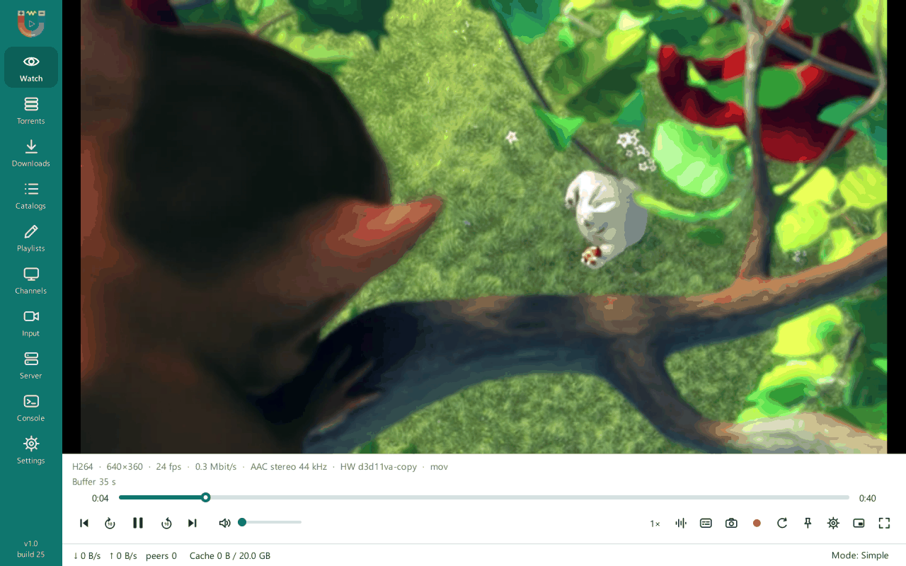
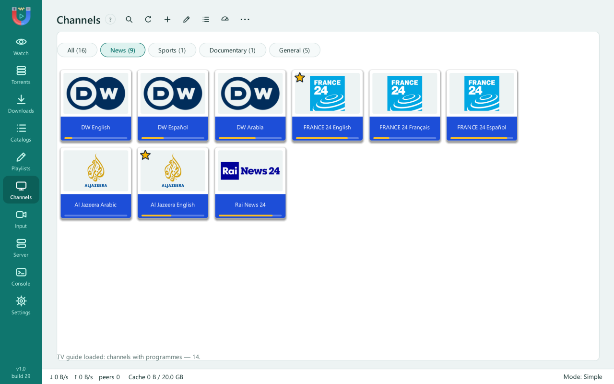
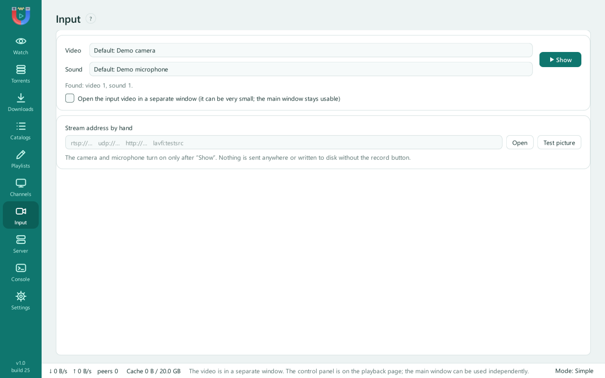
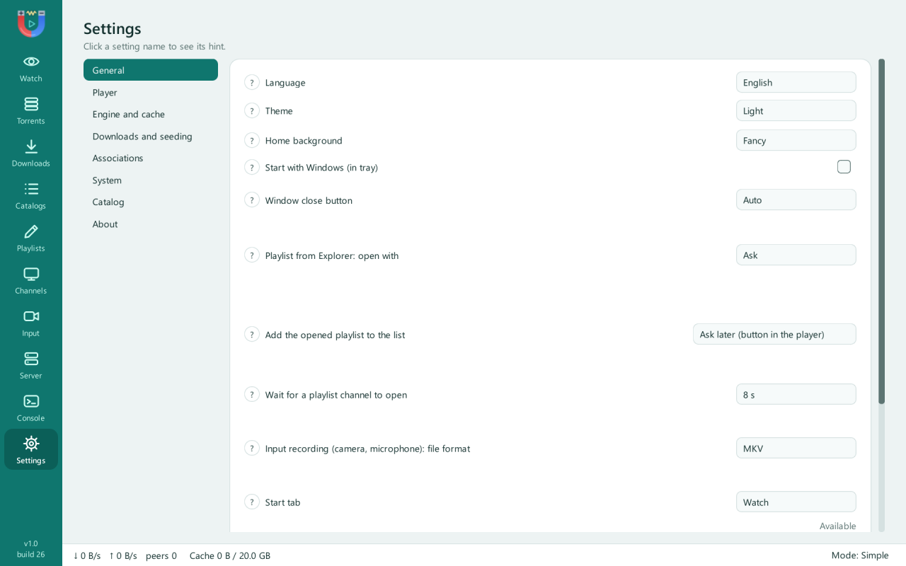
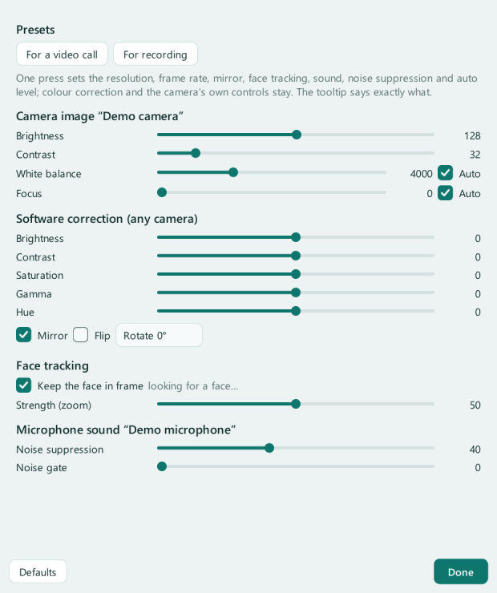

[English](README.md) · [Русский](README.ru.md) · [Українська](README.uk.md)

🌐 All our programs: https://drugoj00.github.io/ · Telegram channel: https://t.me/PhoneInWindowSound

**Vision contains no video or audio content and no links to content.** **Screenshots are shown solely to demonstrate the app's features: the channels in them are not included in Vision, users add their own playlists.**

# Vision for Windows

A video player and torrent downloader for Windows in one window: paste a link, press "Watch", and the film plays at once while it keeps downloading. IPTV channels, camera and microphone input, a separate video window. No ads.

Vision plays files, links, playlists and torrents (magnet and .torrent), including while they download. It is also a full downloader: queue, limits, schedule, seeding, moving finished files.

**The program provides no content. The user is responsible for complying with the copyright laws of their country.**

⭐ If the program is useful, please star this repository: it costs nothing and helps other people find it.

## Download

**Version 2.0.** [Vision-Win-2.0.exe](https://github.com/drugoj00/vision-for-windows/releases/download/v2.0/Vision-Win-2.0.exe) · [Releases](https://github.com/drugoj00/vision-for-windows/releases)

SHA-256: `f249e0681ff6aeae2c51195aa070705d0cc82ca11670aa0d32c5f8cd1cbe2123`

The installer is not yet signed with a publisher certificate: Windows may show a SmartScreen warning ("Unknown publisher"). Press "More info", then "Run anyway". Administrator rights are not needed to install.

## What's new in 2.0

- Playlist wizard: step-by-step adding for beginners (link, file, archive, clipboard, list of addresses); playlists from archives are added by themselves
- Archives with playlists: ZIP, GZ, BZ2, XZ, TAR (also .tar.gz); read in memory, nothing is unpacked to disk

## What was new in 1.0

- Channels as tiles with logos (at least 4 columns in auto mode); add your own playlist by link or from an M3U, M3U8, XSPF or PLS file
- 18+ channels from the user's playlists go to a locked group with a password
- Torrents by magnet and .torrent, watching while downloading, downloader
- Camera and microphone input, face tracking
- Detached video window, recording
- Visible update window, no silent installs
- Settings in groups; Russian, Ukrainian and English, light and dark themes
- Passthrough sound: AC3, E-AC3, DTS, DTS-HD and TrueHD go to the receiver or TV as is (Off / Auto / Manual by format), WASAPI exclusive mode with a fall back to regular sound
- Choice of the sound output device (remembered); during passthrough program sound filters, auto volume and equalizer are off and the program volume does not act
- Optional stop of known third-party sound enhancers while passthrough plays (no registry changes, no administrator rights)
- DTS to AC3 conversion and a separate sync correction in ms for passthrough
- Smaller installer

## Features

- **Passthrough sound.** AC3, E-AC3, DTS, DTS-HD and TrueHD to a receiver or TV as is (Auto or manual by format), WASAPI exclusive mode, device choice, DTS to AC3, sync correction.
- **Watching torrents.** A magnet link, a file or a .torrent address, drag and drop into the window, "Watch link from clipboard". The file list comes first, then the chosen file plays. Seek anywhere, "Continue" from where you stopped.
- **Two engines.** "Auto" (default), "Fast" and "Classic": the fast one drives watching, the classic one handles downloads, the queue and seeding. Choose in Settings → Engine and cache.
- **Downloader.** Queue, speed limits, schedule, seeding (upload, time limit), moving finished files to the folder you need, file check, actions on completion.
- **Player.** Audio and subtitle track choice, external subtitles, speed, frame snapshot, full screen with a panel (hides after 5 seconds or stays), "Click on video" (show the panel or pause), hardware decoding.
- **Channels.** IPTV playlists (M3U, M3U8), groups, favorites, cards with logos, a playlist editor.
- **Input.** Webcams, microphones and other devices: viewing, recording to a file, snapshot, mirror, resolution and frame rate, image and sound settings (auto level, noise suppression), face tracking, presets "For a video call" and "For recording".
- **Separate video window.** Size by mouse wheel, always on top if you choose, transparency, mirror, thin frame; recording goes on while the main window is closed.
- **File types.** Registers .torrent, magnet, .m3u and other types; "Make the default program".
- **Tray icon.** Runs in the background, starts with Windows, a single copy of the program.
- **Browser extension** "Vision-open": sends a link to the program.
- **Updates.** Check on GitHub, checksum verification, a "What's new" window, installation with a visible window.

## Requirements and limits

- Windows 10 (1809 or newer) or Windows 11, 64-bit; not from the Microsoft Store. The installer is not signed with a publisher certificate yet, so SmartScreen may warn
- Internet is needed for torrents and IPTV
- Archives with playlists: ZIP, GZ, BZ2, XZ, TAR; archives with a password, 7z and RAR are not supported
- Face tracking looks for faces seen from the front (not in profile); the face must take at least 15% of the frame width. Camera recording is not cropped: tracking affects the view only
- In countries where torrents are prohibited they are blocked until confirmation; the country is detected offline
- In a window narrower than 900 px channels are shown in 3 columns
- 18+ is sorted out by playlist content (channel name and group), but not when an .m3u is opened directly from Explorer and not in the playlist editor
- In the dark theme dark logos on a dark card have low contrast
- In the WASAPI exclusive mode other applications cannot play on the chosen device while passthrough plays; the volume of a passthrough stream is set on the receiver or TV
- Not verified: passthrough sound on different receivers and TVs (formats, exclusive mode, names of enhancer processes), live TV guide and playback of channels on different hardware, face tracking and presets on different cameras, several monitors in "Cinema" mode, Windows 10 older than 1809

Vision provides no content. The user is responsible for complying with the copyright laws of their country.

## Screenshots

Light theme. A demo clip is used in the frames.

 

 

 

 

## License

Proprietary license, see [LICENSE](LICENSE): all rights reserved; free for personal, non-commercial use, no ads; redistribution only as the original unmodified installer with the author named; the source code is not published. Third-party components keep their own licenses: libmpv (LGPL-2.1+), libtorrent (BSD-3-Clause), anacrolix/torrent (MPL-2.0), Qt for Python / PySide6 (LGPL-3.0), OpenCV face detection cascade (BSD-3-Clause), Python (PSF). Country data: DB-IP "IP to Country Lite" (CC BY 4.0). Links to every component are in [LICENSE](LICENSE).
