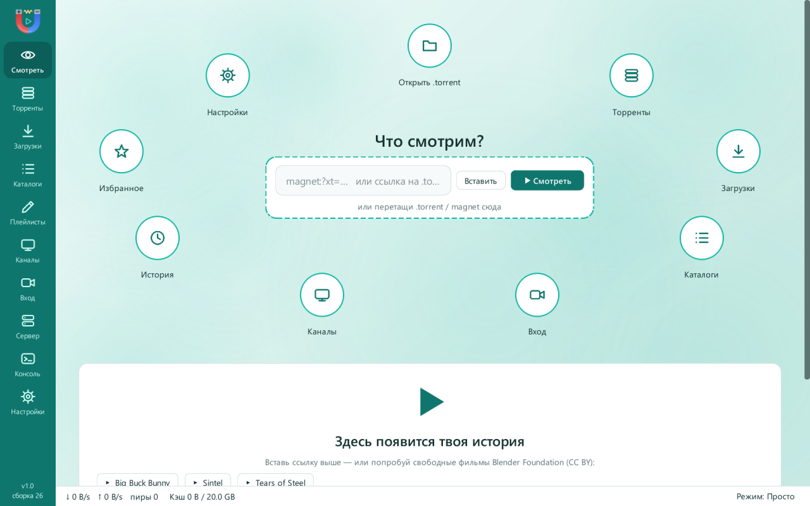
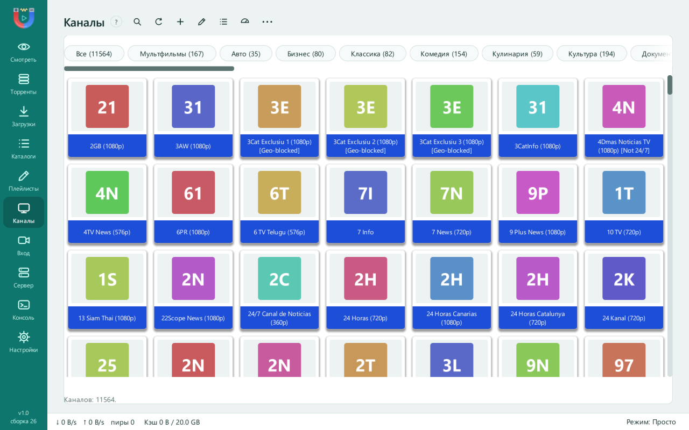
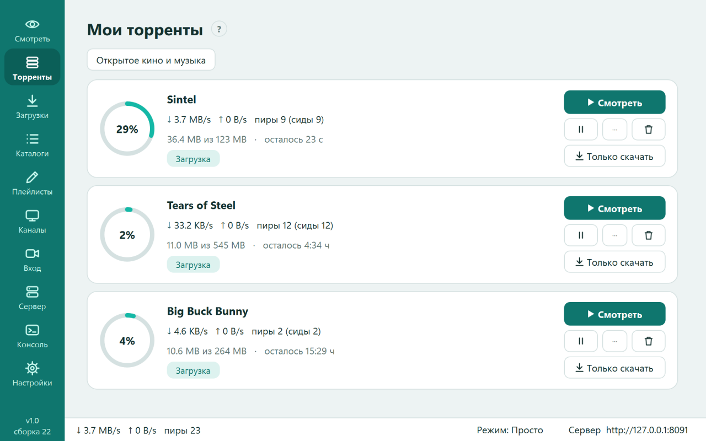
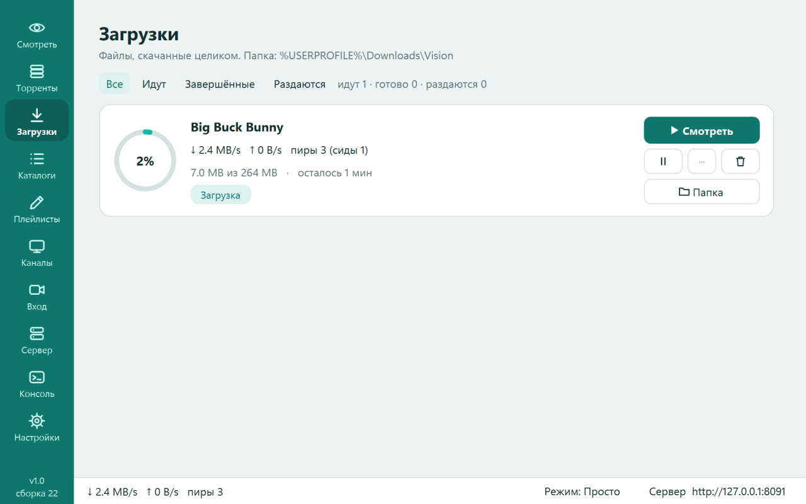
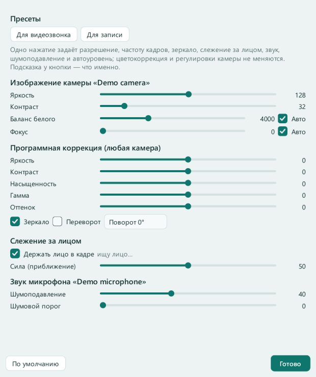

[English](README.md) · [Русский](README.ru.md) · [Українська](README.uk.md)

🌐 Все наши программы: https://drugoj00.github.io/ · Telegram-канал: https://t.me/PhoneInWindowSound

# Vision для Windows

Видеоплеер и торрент-качалка для Windows в одном окне: вставь ссылку, нажми «Смотреть», и фильм играет сразу, пока докачивается. Каналы IPTV, камера и микрофон, отдельное окно видео. Без рекламы.

Vision воспроизводит файлы, ссылки, плейлисты и торренты (magnet и .torrent), в том числе во время загрузки. Есть полноценная качалка: очередь, лимиты, расписание, раздача, перенос завершённых.

**Программа не предоставляет контент. Пользователь отвечает за соблюдение законов своей страны об авторском праве.**

⭐ Если программа пригодилась, поставь звезду этому репозиторию: это бесплатно и помогает другим её найти.

## Скачать

**Версия 1.0.** [Vision-Win-1.0.exe](https://github.com/drugoj00/vision-for-windows/releases/download/v1.0/Vision-Win-1.0.exe) · [Releases](https://github.com/drugoj00/vision-for-windows/releases)

SHA-256: `b9b4bfd8a510dd4775c7e1f544fd312fecc29c89f752fe2bf9d6f7658a93982e`

Установщик пока не подписан сертификатом издателя: Windows может показать предупреждение SmartScreen («Неизвестный издатель»). Нажми «Подробнее», затем «Всё равно выполнить». Права администратора для установки не нужны.

## Что нового в 1.0

- Первый выпуск: просмотр торрентов во время загрузки, качалка, IPTV-каналы, вход с камеры и микрофона
- Отдельное окно видео: чистое, панель по щелчку; пауза, громкость, «вернуть», «закрыть», при записи ещё запись и снимок
- Слежение за лицом и пресеты камеры «Для видеозвонка» и «Для записи»
- Главный экран «Что смотрим?» с кнопками быстрых действий; простой и обычный режимы
- Обновление программы с видимым окном установки, без тихих установок
- Русский, украинский и английский, светлая и тёмная темы

## Возможности

- **Просмотр торрента.** Magnet-ссылка, файл или адрес .torrent, перетаскивание в окно, «Смотреть ссылку из буфера». Сначала список файлов, затем играет выбранный. Перемотка в любое место, «Продолжить» с места остановки.
- **Два движка.** «Авто» (по умолчанию), «Быстрый» и «Классический»: быстрый ведёт просмотр, классический загрузки, очередь и раздачу. Выбор в Настройки → Движок и кэш.
- **Качалка.** Очередь, лимиты скорости, расписание, раздача (отдача, срок), перенос завершённых в нужную папку, проверка файлов, действия по завершении.
- **Плеер.** Выбор дорожек звука и субтитров, внешние субтитры, скорость, снимок кадра, полный экран с панелью (прячется через 5 секунд или остаётся), «Клик по видео» (показать панель или пауза), аппаратное декодирование.
- **Каналы.** Плейлисты IPTV (M3U, M3U8), группы, избранное, карточки с логотипами, редактор плейлистов.
- **Вход.** Веб-камеры, микрофоны и другие устройства: просмотр, запись в файл, снимок, зеркало, разрешение и частота кадров, настройки изображения и звука (автоуровень, шумоподавление), слежение за лицом, пресеты «Для видеозвонка» и «Для записи».
- **Отдельное окно видео.** Размер по колесу мыши, поверх всех окон по выбору, прозрачность, зеркало, тонкая рамка, запись продолжается при закрытом главном окне.
- **Файловые типы.** Регистрация .torrent, magnet, .m3u и других типов; «Сделать программой по умолчанию».
- **Значок у часов.** Работа в фоне, запуск вместе с Windows, одна копия программы.
- **Расширение для браузера** «Vision-open»: отправляет ссылку в программу.
- **Обновления.** Проверка на GitHub, проверка контрольной суммы, окно «Что нового», установка с видимым окном.

## Требования и ограничения

- Windows 10 (1809 и новее) или Windows 11, 64-бит. Нужен интернет для торрентов и IPTV.
- Слежение за лицом ищет лица анфас (не профиль), лицо должно занимать от 15% ширины кадра. Запись с камеры ведётся без кадрирования: слежение действует на показ.
- В странах, где торренты запрещены, они блокируются до подтверждения; страна определяется без интернета.
- Проверено на Windows 11. Не проверено вживую: слежение за лицом и пресеты на разных камерах, работа с несколькими мониторами в режиме «Кино».

## Скриншоты

Светлая тема, язык интерфейса русский. Видео в кадрах: фильмы Blender Foundation «Big Buck Bunny», «Sintel» и «Tears of Steel» (CC BY).

 

 

 

 

 

## Лицензия и благодарности

Программа использует libmpv (LGPL), libtorrent, торрент-движок anacrolix/torrent (MPL-2.0), Qt для Python (PySide6, LGPL) и каскад поиска лиц из OpenCV (BSD).
