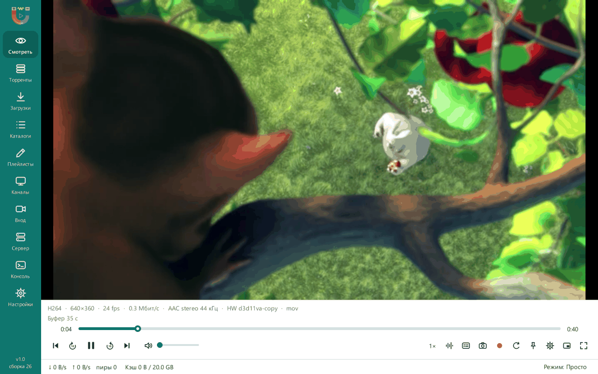
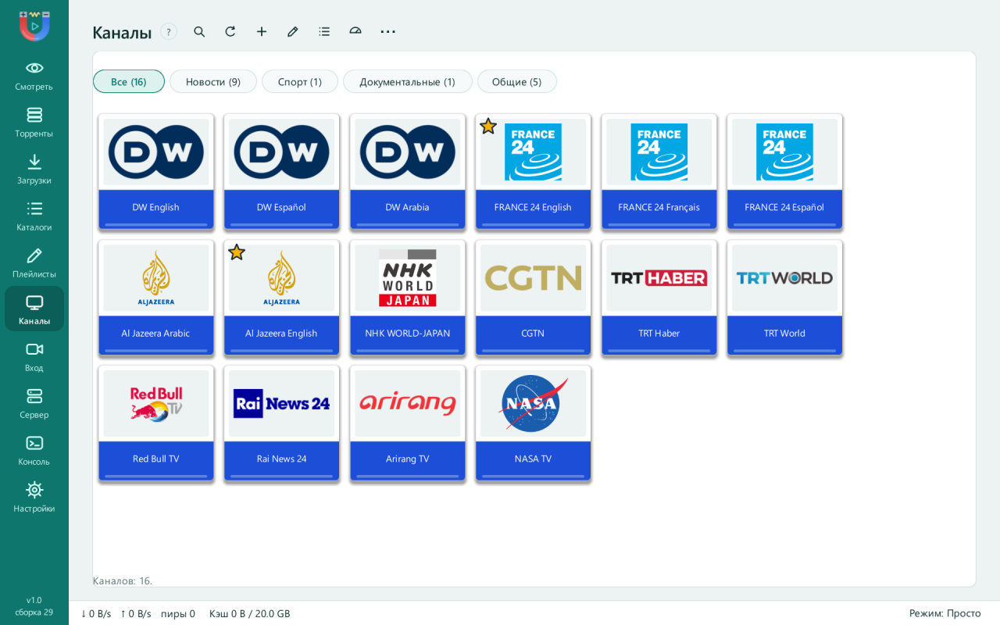
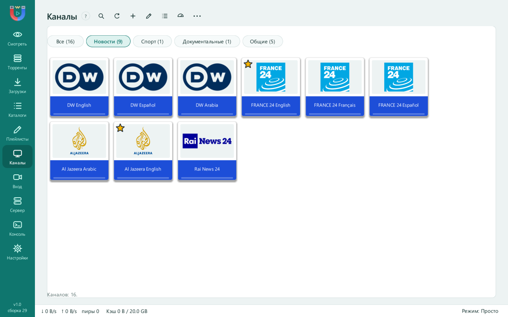
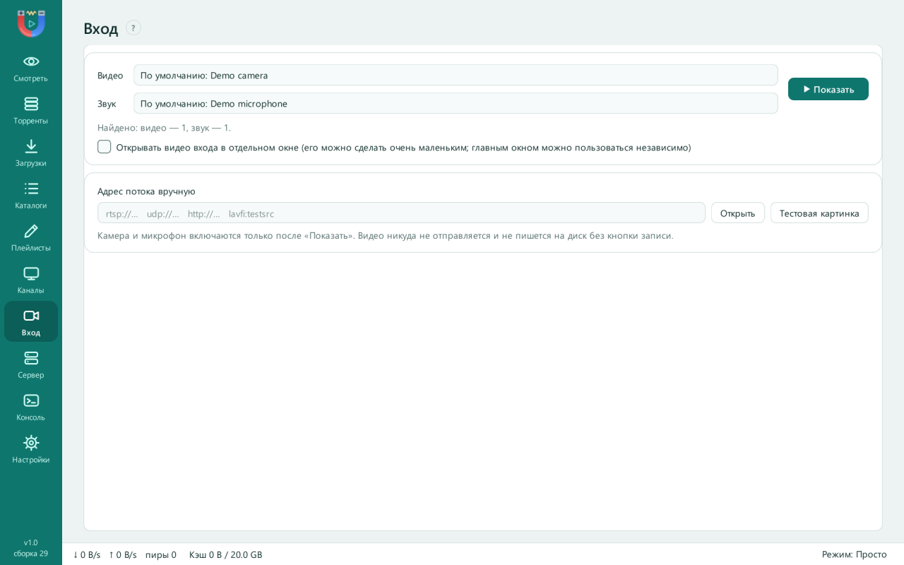
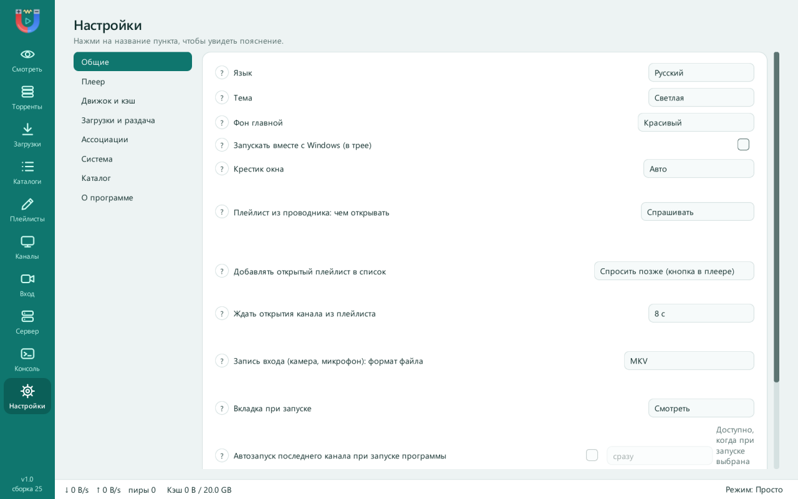
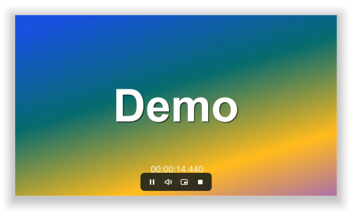

[English](README.md) · [Русский](README.ru.md) · [Українська](README.uk.md)

🌐 Все наши программы: https://drugoj00.github.io/ · Telegram-канал: https://t.me/PhoneInWindowSound

**Vision не содержит видео и аудио контента, а также ссылок на контент.** **Скриншоты приведены исключительно для демонстрации возможностей программы: каналов из скриншотов в Vision нет, пользователь добавляет свои плейлисты сам.**

# Vision для Windows

Видеоплеер и торрент-качалка для Windows в одном окне: вставь ссылку, нажми «Смотреть», и фильм играет сразу, пока докачивается. Каналы IPTV, камера и микрофон, отдельное окно видео. Без рекламы.

Vision воспроизводит файлы, ссылки, плейлисты и торренты (magnet и .torrent), в том числе во время загрузки. Есть полноценная качалка: очередь, лимиты, расписание, раздача, перенос завершённых.

**Программа не предоставляет контент. Пользователь отвечает за соблюдение законов своей страны об авторском праве.**

⭐ Если программа пригодилась, поставь звезду этому репозиторию: это бесплатно и помогает другим её найти.

## Скачать

**Версия 2.0.** [Vision-Win-2.0.exe](https://github.com/drugoj00/vision-for-windows/releases/download/v2.0/Vision-Win-2.0.exe) · [Releases](https://github.com/drugoj00/vision-for-windows/releases)

SHA-256: `f249e0681ff6aeae2c51195aa070705d0cc82ca11670aa0d32c5f8cd1cbe2123`

Установщик пока не подписан сертификатом издателя: Windows может показать предупреждение SmartScreen («Неизвестный издатель»). Нажми «Подробнее», затем «Всё равно выполнить». Права администратора для установки не нужны.

## Что нового в 2.0

- Мастер плейлиста: пошаговое добавление для новичков (ссылка, файл, архив, буфер обмена, список адресов); плейлисты из архивов добавляются сами
- Архивы с плейлистами: ZIP, GZ, BZ2, XZ, TAR (и .tar.gz); читаются в памяти, на диск ничего не распаковывается

## Что было нового в 1.0

- Каналы плитками с логотипами (в авто-режиме не меньше 4 колонок); свой плейлист по ссылке или из файла M3U, M3U8, XSPF, PLS
- 18+ из плейлистов пользователя уходит в запертую группу с паролем
- Торренты по magnet и .torrent, просмотр во время загрузки, качалка
- Вход с камеры и микрофона, слежение за лицом
- Отдельное окно видео, запись
- Видимое окно обновления, без тихих установок
- Настройки по группам; русский, украинский и английский, светлая и тёмная темы
- Сквозной звук: AC3, E-AC3, DTS, DTS-HD и TrueHD уходят на ресивер или телевизор как есть (Выкл / Авто / Вручную по форматам), эксклюзивный режим WASAPI с откатом на обычный звук
- Выбор устройства вывода звука (запоминается); при сквозном звуке фильтры звука программы, автогромкость и эквалайзер отключены, громкость программы не действует
- Остановка известных сторонних улучшайзеров звука на время сквозного звука по выбору (без правки реестра и прав администратора)
- Конвертация DTS в AC3 и отдельная коррекция синхронизации в мс для сквозного звука
- Установщик стал меньше

## Возможности

- **Сквозной звук.** AC3, E-AC3, DTS, DTS-HD, TrueHD на ресивер или телевизор как есть (Авто или вручную по форматам), эксклюзивный WASAPI, выбор устройства, DTS в AC3, коррекция синхронизации.
- **Просмотр торрента.** Magnet-ссылка, файл или адрес .torrent, перетаскивание в окно, «Смотреть ссылку из буфера». Сначала список файлов, затем играет выбранный. Перемотка в любое место, «Продолжить» с места остановки.
- **Два движка.** «Авто» (по умолчанию), «Быстрый» и «Классический»: быстрый ведёт просмотр, классический загрузки, очередь и раздачу. Выбор в Настройки → Движок и кэш.
- **Качалка.** Очередь, лимиты скорости, расписание, раздача (отдача, срок), перенос завершённых в нужную папку, проверка файлов, действия по завершении.
- **Плеер.** Выбор дорожек звука и субтитров, внешние субтитры, скорость, снимок кадра, полный экран с панелью (прячется через 5 секунд или остаётся), «Клик по видео» (показать панель или пауза), аппаратное декодирование.
- **Каналы.** Плейлисты IPTV (M3U, M3U8), группы, избранное, карточки с логотипами, редактор плейлистов.
- **Вход.** Веб-камеры, микрофоны и другие устройства: просмотр, запись в файл, снимок, зеркало, разрешение и частота кадров, настройки изображения и звука (автоуровень, шумоподавление), слежение за лицом, пресеты «Для видеозвонка» и «Для записи».
- **Отдельное окно видео.** Размер по колесу мыши, поверх всех окон по выбору, прозрачность, зеркало, тонкая рамка, запись продолжается при закрытом главном окне.
- **Файловые типы.** Регистрация .torrent, magnet, .m3u и других типов; «Сделать программой по умолчанию».
- **Значок у часов.** Работа в фоне, запуск вместе с Windows, одна копия программы.
- **Расширение для браузера** «Vision-open»: отправляет ссылку в программу.
- **Обновления.** Проверка на GitHub, проверка контрольной суммы, окно «Что нового», установка с видимым окном.

## Требования и ограничения

- Windows 10 (1809 и новее) или Windows 11, 64-бит; не из Microsoft Store. Установщик пока не подписан сертификатом издателя, SmartScreen может предупредить
- Интернет нужен для торрентов и IPTV
- Архивы с плейлистами: ZIP, GZ, BZ2, XZ, TAR; архивы с паролем, 7z и RAR не поддерживаются
- Слежение за лицом ищет лица анфас (не профиль), лицо должно занимать от 15% ширины кадра. Запись с камеры ведётся без кадрирования: слежение действует на показ
- В странах, где торренты запрещены, они блокируются до подтверждения; страна определяется без интернета
- При ширине окна меньше 900 px каналы идут в 3 колонки
- 18+ отбирается по содержимому плейлиста (название и группа канала), но не при прямом открытии .m3u из проводника и не в редакторе плейлистов
- В тёмной теме тёмные логотипы на тёмной карточке малоконтрастны
- В эксклюзивном режиме WASAPI другие приложения не могут играть на выбранном устройстве, пока идёт сквозной звук; громкость сквозного потока регулируется на ресивере или телевизоре
- Не проверено: сквозной звук на разных ресиверах и телевизорах (форматы, эксклюзивный режим, имена процессов улучшайзеров), живая программа передач и воспроизведение каналов на разном оборудовании, слежение за лицом и пресеты на разных камерах, несколько мониторов в режиме «Кино», Windows 10 ниже 1809

Vision не предоставляет контент. Пользователь отвечает за соблюдение законов своей страны об авторском праве.

## Скриншоты

Светлая тема, язык интерфейса русский. В кадрах использован демо-ролик.

 

 

 

 

## Лицензия

Собственная лицензия, см. [LICENSE](LICENSE): все права защищены; бесплатно для личного некоммерческого использования, без рекламы; распространять можно только оригинальный неизменённый установщик с указанием автора; исходный код не публикуется. Сторонние компоненты сохраняют свои лицензии: libmpv (LGPL-2.1+), libtorrent (BSD-3-Clause), anacrolix/torrent (MPL-2.0), Qt для Python / PySide6 (LGPL-3.0), каскад поиска лиц из OpenCV (BSD-3-Clause), Python (PSF). Данные о странах: DB-IP «IP to Country Lite» (CC BY 4.0). Ссылки на все компоненты есть в [LICENSE](LICENSE).
