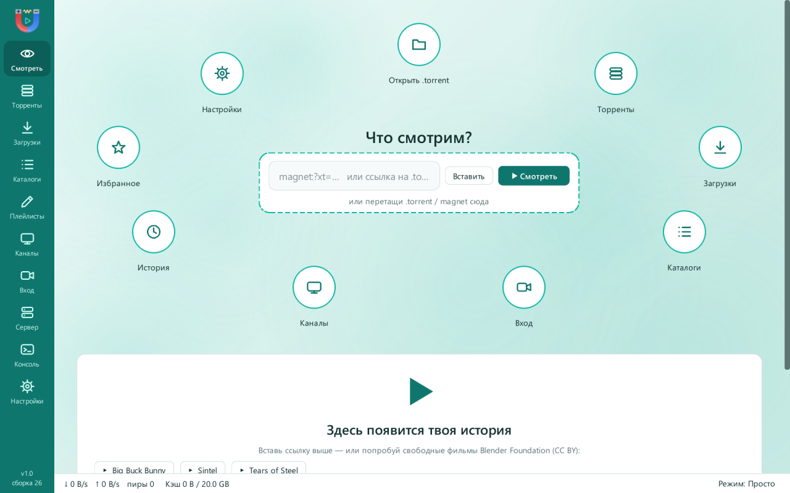
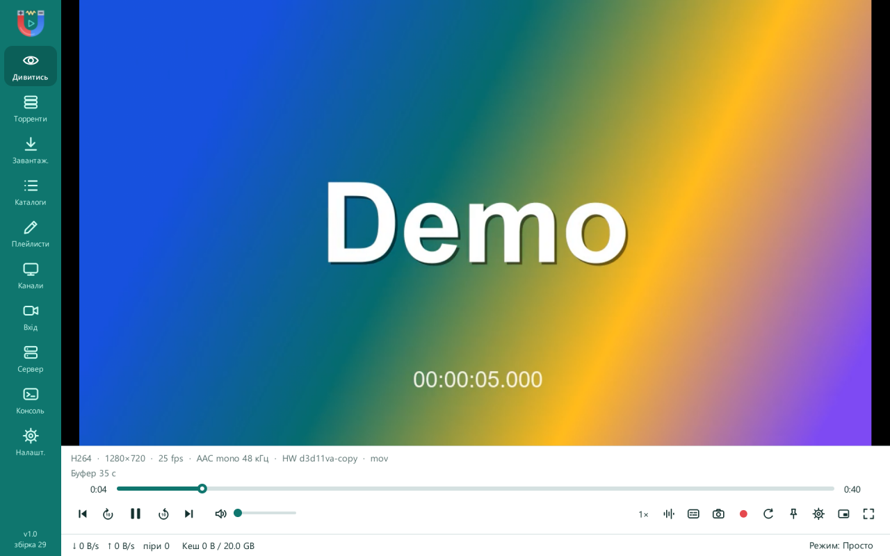
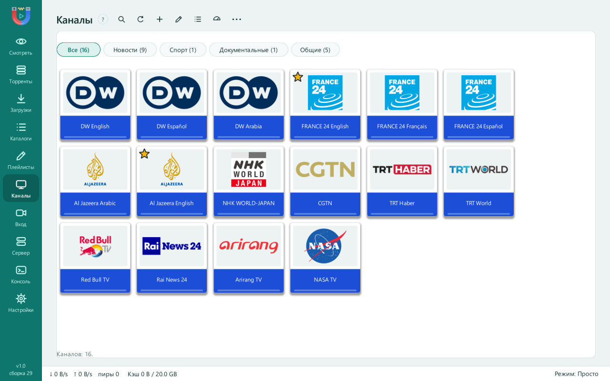
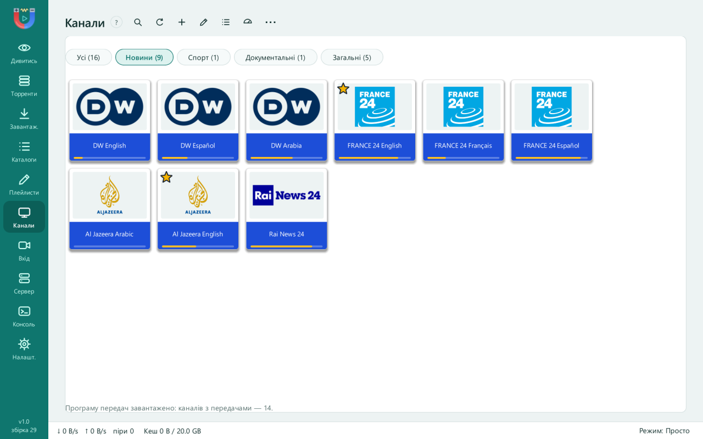
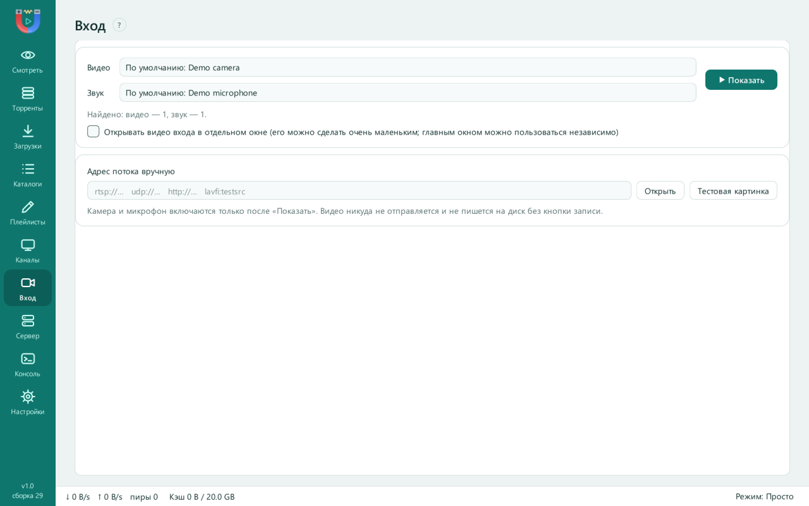
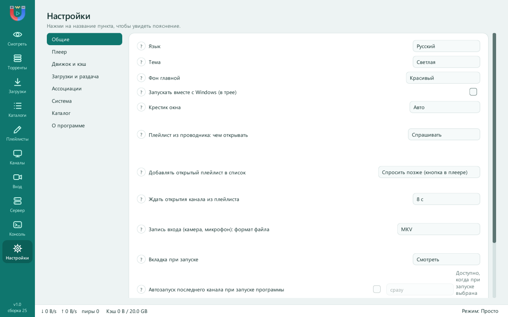
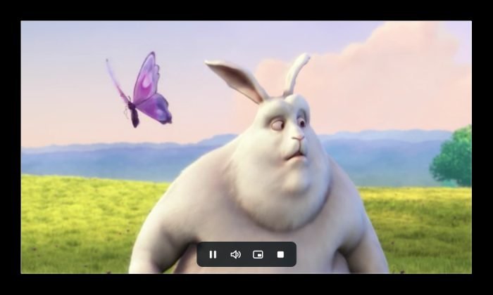
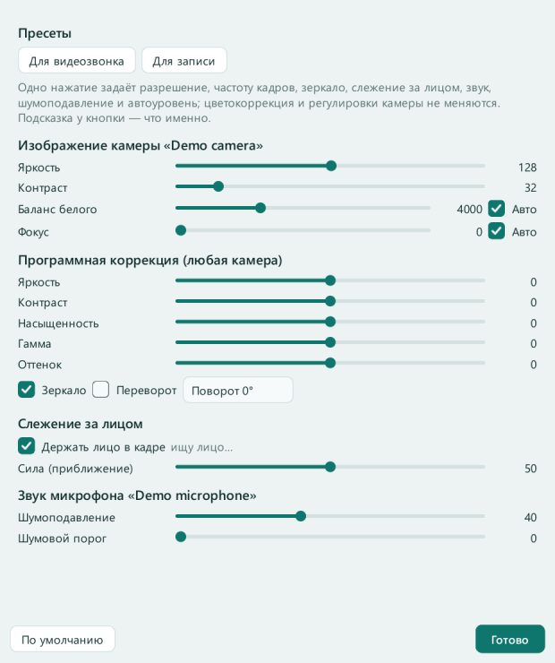

[English](README.md) · [Русский](README.ru.md) · [Українська](README.uk.md)

🌐 Усі наші програми: https://drugoj00.github.io/ · Telegram-канал: https://t.me/PhoneInWindowSound

**Vision не містить відео й аудіо контенту, а також посилань на контент.** **Скриншоти наведені виключно для демонстрації можливостей програми: каналів зі скриншотів у Vision немає, користувач додає власні плейлісти сам.**

# Vision для Windows

Відеоплеєр і торент-завантажувач для Windows в одному вікні: встав посилання, натисни «Дивитися», і фільм грає одразу, поки докачується. Канали IPTV, камера й мікрофон, окреме вікно відео. Без реклами.

Vision відтворює файли, посилання, плейлисти й торенти (magnet і .torrent), зокрема під час завантаження. Є повноцінний завантажувач: черга, ліміти, розклад, роздача, перенесення завершених.

**Програма не надає контент. Користувач відповідає за дотримання законів своєї країни про авторське право.**

⭐ Якщо програма стала в пригоді, постав зірку цьому репозиторію: це безкоштовно й допомагає іншим її знайти.

## Завантажити

**Версія 2.0.** [Vision-Win-2.0.exe](https://github.com/drugoj00/vision-for-windows/releases/download/v2.0/Vision-Win-2.0.exe) · [Releases](https://github.com/drugoj00/vision-for-windows/releases)

SHA-256: `f249e0681ff6aeae2c51195aa070705d0cc82ca11670aa0d32c5f8cd1cbe2123`

Інсталятор поки не підписано сертифікатом видавця: Windows може показати попередження SmartScreen («Невідомий видавець»). Натисни «Докладніше», потім «Усе одно виконати». Права адміністратора для встановлення не потрібні.

## Що нового в 2.0

- Майстер плейлиста: покрокове додавання для новачків (посилання, файл, архів, буфер обміну, список адрес); плейлисти з архівів додаються самі
- Архіви з плейлистами: ZIP, GZ, BZ2, XZ, TAR (і .tar.gz); читаються в пам'яті, на диск нічого не розпаковується

## Що було нового в 1.0

- Канали плитками з логотипами (в авто-режимі не менше 4 колонок); власний плейлист за посиланням або з файлу M3U, M3U8, XSPF, PLS
- 18+ з плейлістів користувача потрапляє в замкнену групу з паролем
- Торенти за magnet і .torrent, перегляд під час завантаження, завантажувач
- Вхід з камери й мікрофона, стеження за обличчям
- Окреме вікно відео, запис
- Видиме вікно оновлення, без тихих встановлень
- Налаштування за групами; російська, українська й англійська, світла й темна теми
- Наскрізний звук: AC3, E-AC3, DTS, DTS-HD і TrueHD йдуть на ресивер або телевізор як є (Вимк / Авто / Вручну за форматами), ексклюзивний режим WASAPI з відкатом на звичайний звук
- Вибір пристрою виводу звуку (запам'ятовується); під час наскрізного звуку фільтри звуку програми, автогучність і еквалайзер вимкнені, гучність програми не діє
- Зупинка відомих сторонніх покращувачів звуку на час наскрізного звуку за вибором (без зміни реєстру й прав адміністратора)
- Конвертація DTS в AC3 і окрема корекція синхронізації в мс для наскрізного звуку
- Інсталятор став меншим

## Можливості

- **Наскрізний звук.** AC3, E-AC3, DTS, DTS-HD, TrueHD на ресивер або телевізор як є (Авто або вручну за форматами), ексклюзивний WASAPI, вибір пристрою, DTS в AC3, корекція синхронізації.
- **Перегляд торента.** Magnet-посилання, файл або адреса .torrent, перетягування у вікно, «Дивитися посилання з буфера». Спершу список файлів, потім грає вибраний. Перемотування в будь-яке місце, «Продовжити» з місця зупинки.
- **Два рушії.** «Авто» (за замовчуванням), «Швидкий» і «Класичний»: швидкий веде перегляд, класичний завантаження, чергу й роздачу. Вибір у Налаштування → Рушій і кеш.
- **Завантажувач.** Черга, ліміти швидкості, розклад, роздача (віддача, строк), перенесення завершених у потрібну теку, перевірка файлів, дії після завершення.
- **Плеєр.** Вибір доріжок звуку й субтитрів, зовнішні субтитри, швидкість, знімок кадру, повний екран із панеллю (ховається через 5 секунд або залишається), «Клац по відео» (показати панель або пауза), апаратне декодування.
- **Канали.** Плейлисти IPTV (M3U, M3U8), групи, обране, картки з логотипами, редактор плейлистів.
- **Вхід.** Вебкамери, мікрофони та інші пристрої: перегляд, запис у файл, знімок, дзеркало, роздільність і частота кадрів, налаштування зображення й звуку (авторівень, шумозаглушення), стеження за обличчям, пресети «Для відеодзвінка» та «Для запису».
- **Окреме вікно відео.** Розмір колесом миші, поверх усіх вікон за вибором, прозорість, дзеркало, тонка рамка, запис триває за закритого головного вікна.
- **Типи файлів.** Реєстрація .torrent, magnet, .m3u та інших типів; «Зробити програмою за замовчуванням».
- **Значок біля годинника.** Робота у фоні, запуск разом із Windows, одна копія програми.
- **Розширення для браузера** «Vision-open»: надсилає посилання в програму.
- **Оновлення.** Перевірка на GitHub, перевірка контрольної суми, вікно «Що нового», встановлення з видимим вікном.

## Вимоги й обмеження

- Windows 10 (1809 і новіша) або Windows 11, 64-біт; не з Microsoft Store. Інсталятор поки не підписаний сертифікатом видавця, SmartScreen може попередити
- Потрібен інтернет для торентів та IPTV
- Архіви з плейлистами: ZIP, GZ, BZ2, XZ, TAR; архіви з паролем, 7z і RAR не підтримуються
- Стеження за обличчям шукає обличчя анфас (не профіль), обличчя має займати від 15% ширини кадру. Запис із камери ведеться без кадрування: стеження діє на показ
- У країнах, де торенти заборонені, вони блокуються до підтвердження; країна визначається без інтернету
- За ширини вікна менше 900 px канали йдуть у 3 колонки
- 18+ відбирається за вмістом плейлиста (назва й група каналу), але не під час прямого відкриття .m3u з провідника і не в редакторі плейлістів
- У темній темі темні логотипи на темній картці малоконтрастні
- В ексклюзивному режимі WASAPI інші програми не можуть грати на вибраному пристрої, поки триває наскрізний звук; гучність наскрізного потоку регулюється на ресивері або телевізорі
- Не перевірено: наскрізний звук на різних ресиверах і телевізорах (формати, ексклюзивний режим, імена процесів покращувачів), жива програма передач і відтворення каналів на різному обладнанні, стеження за обличчям і пресети на різних камерах, кілька моніторів у режимі «Кіно», Windows 10 нижче 1809

Vision не надає контент. Користувач відповідає за дотримання законів своєї країни про авторське право.

## Знімки екрана

Світла тема, мова інтерфейсу українська. У кадрах використано демо-ролик.

 

 

 

 

## Ліцензія

Власна ліцензія, див. [LICENSE](LICENSE): усі права захищено; безкоштовно для особистого некомерційного використання, без реклами; поширювати можна лише оригінальний незмінений інсталятор із зазначенням автора; вихідний код не публікується. Сторонні компоненти зберігають свої ліцензії: libmpv (LGPL-2.1+), libtorrent (BSD-3-Clause), anacrolix/torrent (MPL-2.0), Qt для Python / PySide6 (LGPL-3.0), каскад пошуку облич з OpenCV (BSD-3-Clause), Python (PSF). Дані про країни: DB-IP «IP to Country Lite» (CC BY 4.0). Посилання на всі компоненти є в [LICENSE](LICENSE).
